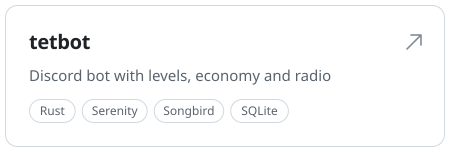
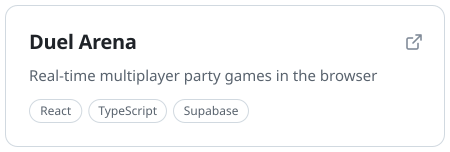
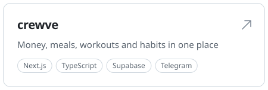
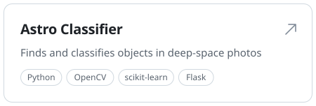

<a href="https://github.com/tetwy/tetbot-showcase"><picture><source media="(prefers-color-scheme: dark)" srcset="assets/card-tetbot-dark.svg"></picture></a>
<a href="https://duel-arena-games-728r.vercel.app"><picture><source media="(prefers-color-scheme: dark)" srcset="assets/card-duel-arena-dark.svg"></picture></a>
 
<a href="https://github.com/tetwy/crewve-showcase"><picture><source media="(prefers-color-scheme: dark)" srcset="assets/card-crewve-dark.svg"></picture></a>
<a href="https://github.com/tetwy/astro-siniflandirici"><picture><source media="(prefers-color-scheme: dark)" srcset="assets/card-astro-classifier-dark.svg"></picture></a>

<picture>
  <source media="(prefers-color-scheme: dark)" srcset="assets/stack-dark.svg">
  
</picture>

<a href="https://musagdg.com">musagdg.com</a> &nbsp;·&nbsp; <a href="https://www.linkedin.com/in/musa-agdag-0313052bb/">LinkedIn</a>

