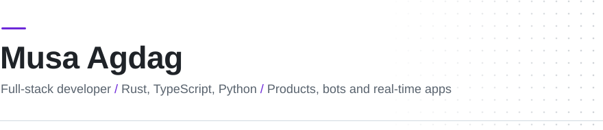

<picture>
  <source media="(prefers-color-scheme: dark)" srcset="assets/header-dark.svg">
  <source media="(prefers-color-scheme: light)" srcset="assets/header-light.svg">
  
</picture>

I design and build software end to end: Rust services and Discord bots on the backend, React and Next.js on the frontend, Supabase and SQL underneath. AI is part of my everyday toolchain; the architecture, the tests and what goes to production stay my responsibility.

**Now:** growing Duel Arena from two games into a platform for many real-time party games.

## Selected work

<table>
<tr>
<td width="50%" valign="top">

### [tetbot](https://github.com/tetwy/tetbot-showcase)

A Discord bot in Rust that gives a server its own world: voice-time levels, a virtual economy with banking and a stock market, mini games played with virtual coins (no real money), creature hunting and a radio.

`Rust` `Serenity` `Poise` `Songbird` `SQLite` `Docker`

[Showcase](https://github.com/tetwy/tetbot-showcase)

</td>
<td width="50%" valign="top">

### [Duel Arena](https://github.com/tetwy/duel-arena-games)

A real-time multiplayer party game platform: open a room, share the link, play. Starts with Veto, a Taboo-style word duel, and Harfbaz, a fast category word race.

`React` `TypeScript` `Vite` `Tailwind CSS` `Supabase`

[Live demo](https://duel-arena-games-728r.vercel.app) &nbsp;·&nbsp; [Repository](https://github.com/tetwy/duel-arena-games)

</td>
</tr>
</table>

<table>
<tr>
<td width="50%" valign="top">

### [crewve](https://github.com/tetwy/crewve-showcase)

One dashboard for money, meals, workouts and habits. Log entries on the web, or text a Telegram bot in plain language and confirm before anything is saved.

`Next.js` `React` `TypeScript` `Supabase` `Tailwind CSS` `Telegram Bot API`

[Showcase](https://github.com/tetwy/crewve-showcase)

</td>
<td width="50%" valign="top">

### [Astro Classifier](https://github.com/tetwy/astro-siniflandirici)

Finds objects in deep-space photos with an OpenCV detector and sorts them into six classes, such as star, galaxy and nebula, with a trained random forest model.

`Python` `Flask` `OpenCV` `scikit-learn` `React` `TypeScript`

[Repository](https://github.com/tetwy/astro-siniflandirici)

</td>
</tr>
</table>

Also: [Compiled Studios](https://compiled-studios.vercel.app), the website of an indie game studio and its first title, How to Pirate, a physics-driven co-op adventure for 2 to 4 players. Built with React, Vite and Tailwind CSS.

## Toolbox

| Area | Tools |
| :--- | :--- |
| Languages | TypeScript, Rust, Python, C#, SQL |
| Frontend | React, Next.js, Vite, Tailwind CSS, shadcn/ui, Framer Motion, TanStack Query |
| Backend and data | Supabase (Postgres, Auth, RLS, Realtime), SQLite, Axum, Tokio, Flask, Express, Sanity |
| Bots and integrations | Serenity, Poise, Songbird, Telegram Bot API |
| AI and ML | scikit-learn, OpenCV, pandas, LLM APIs (Groq, Gemini) |
| Game development | Unity |
| DevOps and cloud | Docker, GitHub Actions, Vercel, Netlify, Linux and systemd, Prometheus metrics |

## Contact

[musagdg.com](https://musagdg.com) &nbsp;·&nbsp; [LinkedIn](https://www.linkedin.com/in/musa-agdag-0313052bb/)

Open to collaborating on products that need to be built from idea to launch.
